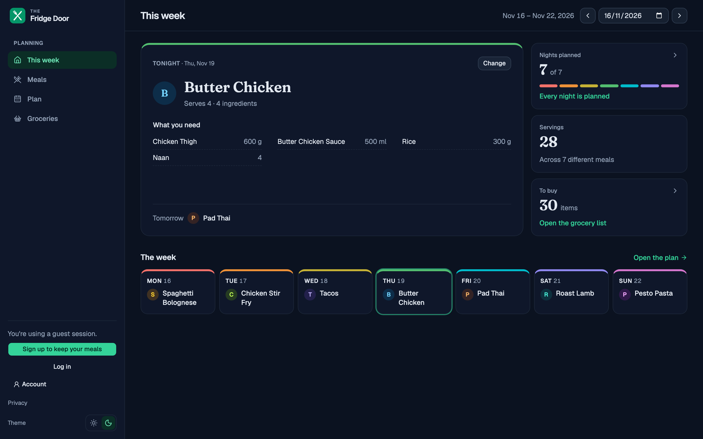
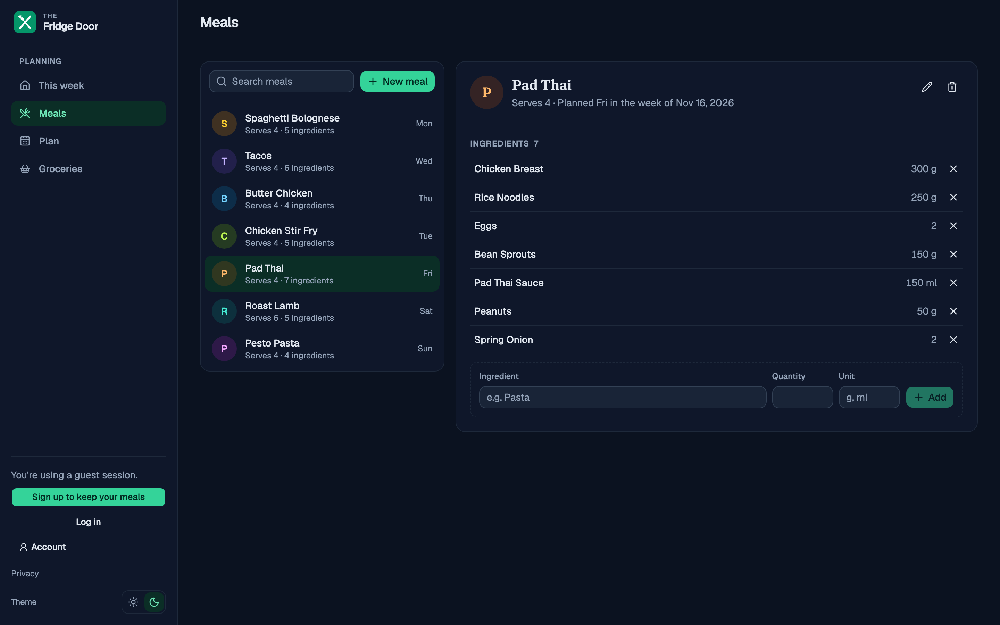
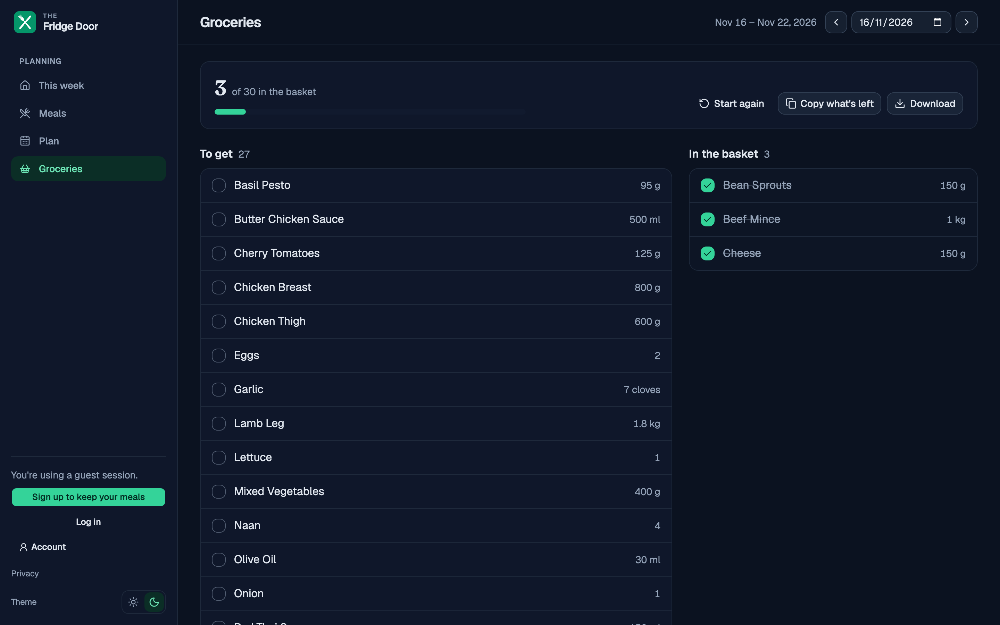
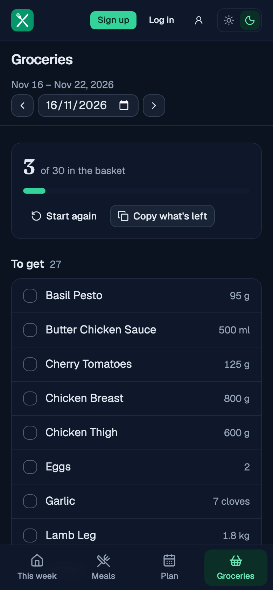

# The Fridge Door

[](https://github.com/rileyrushton05/the-fridge-door/actions/workflows/tests.yml)

Plan a week of meals and get one grocery list for all of it. A React and
TypeScript frontend over a FastAPI backend, on Postgres.

**[Try it: meal-planner-liard-ten.vercel.app](https://meal-planner-liard-ten.vercel.app/)**,
with no sign-up: a first visit opens as a guest with a few meals already
planned.

<picture>
  <source media="(prefers-color-scheme: light)" srcset="docs/images/this-week-light.png">
  
</picture>

<table>
  <tr>
    <td width="50%"></td>
    <td width="50%"></td>
  </tr>
</table>

## Engineering highlights

- **Two walls around everyone's data.** Every query is scoped to the person
  asking, and Postgres row-level security filters again underneath, so a
  query that forgot its filter still returns nothing of anyone else's. The
  tests prove it connected as the app's own restricted role.
  ([security](docs/security.md#data))
- **No route ships open.** A test reads the API's own route table and checks
  that every data route refuses a request without a session, so a new
  endpoint that forgets the check fails the build.
- **3.4 s to 0.11 s** to change week, by measuring first: colocating the
  functions with the database and cutting round trips, not tuning queries.
  ([latency](#latency))
- **Types from the API, not by hand.** The TypeScript the frontend uses is
  generated from the OpenAPI document, and CI fails if either is stale, so a
  renamed field breaks the build rather than the page.
- **Schema changes that cannot drift.** CI fails a model change that has no
  migration, proves every migration reversible, and runs the whole suite on
  SQLite and on Postgres. Production migrations wait for approval.
  ([operations](docs/operations.md#migrations))
- **Accounts done carefully:** argon2id, hashed session tokens, throttled
  logins that answer identically whether the email exists or not, recovery
  codes instead of email, a strict Content-Security-Policy checked in every
  browser test, and error reports that never say who.
  ([security](docs/security.md))

## Features



- **Start straight away.** A first visit opens as a guest with three sample
  meals planned on four days of the current week, so the grocery list has
  something to show. Signing up keeps everything; logging in on another
  device brings it back.
- **This week** opens on tonight's meal and what it needs, tomorrow's, and
  how much of the week is planned.
- **Meals** with a serving size and ingredients, with autocomplete over
  ingredients already used. Names match ignoring case, so "Eggs" and "eggs"
  stay one item rather than splitting the shopping list.
- **About 40 templates** of common meals, ingredients filled in, added in
  one click.
- **Weekly plan:** pick a meal and servings for each day of any week; it
  saves as you go, with undo. Weeks are independent, and "copy last week"
  carries one forward.
- **Grocery list:** everything planned for the week, totalled. Metric mass
  and volume (mg/g/kg, ml/L) convert to a common unit before merging, and
  quantities scale when a day cooks for more or fewer than the recipe. Tick
  things off as they go in the basket and copy what's left, or download the
  whole list.
- **An ingredient catalogue** links ingredients to about 80 common grocery
  items by name or alias, ready for grouping the list by aisle.
- **Your data is yours:** download all of it as JSON, or delete the account
  and everything in it, from the Account page.
- **Phone and desktop, light and dark.**

<br clear="right">

## Privacy

What the app keeps, in plain terms (also in the app, at `/privacy`):

- **An account** is an email, used only as a login name and never sent
  anything, plus a password and a recovery code stored only as one-way
  hashes (argon2id and SHA-256). Then the meals, ingredients and planned
  days you add.
- **A session** is a cookie; the database holds only its hash, and it ends
  after 30 days. **A guest** has no email or password at all, and a guest
  unused for 30 days is deleted with everything in it by a nightly job.
- **Logs** never record email addresses, passwords, tokens or IP addresses.
  Login throttling counts keyed hashes of the email and network, never the
  values, and forgets them after a day. **Error reports** (Sentry, EU) carry
  what broke, never who.
- **Where:** Vercel and Neon in Sydney; Sentry in the EU. No ads, analytics
  or third-party scripts.
- **Leaving:** the Account page downloads everything as JSON and deletes the
  account, and everything it owns, at once, signing out every device.

## Architecture

Three layers, each ignorant of the ones around it:

```
web/ (React)  →  server/ (FastAPI)  →  app/ (domain)  →  Postgres / SQLite
```

- **`app/`** owns the domain and knows nothing about HTTP. `Database` holds the
  engine and opens transactions; the repositories work inside whichever one
  they are handed and never commit, so each API request lands completely or
  rolls back as a whole, and the commit finishes before the response is sent.
- **`server/`** translates HTTP to repository calls and contains no SQL. Domain
  errors map to status codes and RFC 9457 problem responses, so messages
  written for users surface verbatim.
- **`web/`** renders, and holds server state in TanStack Query. It loads a
  week in a single request and works from memory afterwards: mutations patch
  the cache from the API's response rather than refetching. Each page has
  its own address (`/meals`, `/plan`, `/groceries`) and the week is in the
  query string, so a refresh, the back button or a shared link opens the same
  view. The theme, light or dark, is applied before first paint. Built on
  shadcn/ui over Base UI primitives, so dialogs and selects are accessible
  without hand-rolling them.

Nothing above `Database` knows which backend is in use: swapping SQLite for
Postgres is one environment variable.

**Stack:** React 19, TypeScript, Vite, Tailwind CSS 4, TanStack Query and
shadcn/ui; FastAPI, SQLModel and Alembic on Python; Postgres on Neon;
Vercel, in Sydney. Tested with pytest, Vitest and Playwright; errors to
Sentry.

### Latency

Most of the design here is a response to one measurement: a round trip to a
database on another continent cost **325 ms**, so what mattered was the number
of round trips, not the speed of any query.

| | Before | After |
|---|---|---|
| Grocery list for a week | 48 queries | 1 |
| Saving a week's plan | 14 statements | 2 |
| One HTTP request | up to 4 transactions | 1 |
| Changing week | 3.4 s | 0.11 s |

Four changes, in order of how much they bought:

1. **Colocation.** Functions run in `syd1`, next to the `ap-southeast-2`
   database and the person using it. Previously the request crossed the
   Pacific twice. A round trip fell from 325 ms to 41 ms.
2. **Fetch only what changed.** Meals, templates and ingredient names do not
   vary by week, so changing week asks for the plan alone. Weeks already
   visited are served from memory and issue no request at all.
3. **One transaction per request.** Each repository used to open its own
   session, so a request touching three of them paid three BEGIN/COMMIT
   pairs: 1.5 s of the original 3.4 s was transaction overhead alone.
4. **One query, not N.** The grocery list is a single four-table join rather
   than a query per meal and per ingredient.

The frontend loads a week in one request and works from memory afterwards, so
changing page or opening a dropdown touches no network at all. Only changes
hit the API.

### Data model

Everything a person creates belongs to one row in `users`: their `meals`,
their `ingredients` (each person's own, so the autocomplete never suggests a
stranger's), the `meal_ingredients` pairing them with quantities, and their
`weekly_plans`, one row per day per week. Ingredients may link to the shared
ingredient catalogue. Names are unique per person ignoring case, quantities
and servings are positive, and days are weekdays, all enforced by the
database rather than only in Python.

The full schema, an ER diagram, and what happens on delete are in
[docs/database-schema.md](docs/database-schema.md).

### Repository layout

```
the-fridge-door/
├── app/                    # Domain layer: no HTTP
│   ├── db.py               #   Database: owns the engine, one transaction per request
│   ├── models.py           #   SQLModel tables and enums
│   ├── repositories.py     #   Data access, always for one user
│   ├── auth.py             #   Guests, signup, login, sessions
│   ├── security.py         #   Password hashing and session tokens
│   ├── ratelimit.py        #   Login and signup throttling
│   ├── planner.py          #   A week's plan → one grocery list
│   ├── units.py            #   Unit conversion and quantity formatting
│   ├── catalog.py          #   Ingredient catalogue: loading, matching, syncing
│   ├── catalog.csv         #   The catalogue itself: items, aisles, aliases
│   ├── templates.py        #   Starter meals
│   ├── samples.py          #   What a new guest starts with
│   ├── readiness.py        #   The database checks behind /health/ready
│   ├── events.py           #   Security events, logged without personal data
│   ├── jobs.py             #   Scheduled maintenance (purge-guests, sync-catalog)
│   └── cli.py              #   Owner commands (set-password, claim-account)
├── server/                 # FastAPI: HTTP in, repository calls out, no SQL
│   ├── main.py             #   App setup and middleware order
│   ├── deps.py             #   The request's transaction and who is asking
│   ├── schemas.py          #   Request and response shapes
│   ├── problems.py         #   RFC 9457 error responses
│   ├── origin.py           #   Refusing writes sent by other websites
│   ├── headers.py          #   Security headers on API responses
│   ├── observability.py    #   Request ids and structured logs
│   ├── monitoring.py       #   Error reports to Sentry, scrubbed
│   └── routers/            #   auth, account, meals, plans, state, health, monitoring
├── api/index.py            # Vercel serverless entry point
├── web/                    # React + TypeScript + Tailwind
│   ├── src/
│   │   ├── api/            #   Typed client; schema.ts is generated from the API
│   │   ├── components/     #   Pages and parts; ui/ holds the shadcn primitives
│   │   ├── hooks/          #   Server state (TanStack Query), basket, theme
│   │   └── lib/            #   Dates, the URL as state, quantities, monitoring
│   ├── e2e/                #   Playwright specs
│   └── screenshots/        #   The images in this README (npm run screenshots)
├── migrations/             # Alembic revision history
├── tests/                  # Python suite, run against SQLite and Postgres
├── scripts/                # OpenAPI export, database report, password list
├── docs/                   # Security, operations, schema, conventions
└── vercel.json             # Region, build and the page's security headers
```

## Running it locally

```bash
git clone https://github.com/rileyrushton05/the-fridge-door.git && cd the-fridge-door
python3 -m venv venv && source venv/bin/activate
pip install -e ".[dev]"
cd web && npm install && cd ..
```

Two processes. The Vite dev server proxies `/api` to the backend, so the
frontend uses the same relative URLs it will in production.

```bash
uvicorn server.main:app --reload --no-access-log --port 8000   # terminal 1
cd web && npm run dev                                           # terminal 2
```

The frontend runs on `http://localhost:5173`, and interactive API docs are at
`http://localhost:8000/docs`.

The database is chosen entirely by `MEAL_PLANNER_DB_URL`:

| Environment | Value | Result |
|---|---|---|
| Local | unset | SQLite at `data/data.db`, migrated at startup |
| Deployment | `postgresql+psycopg://…` | Neon Postgres |
| Tests | set per test | Temporary SQLite, or `TEST_DATABASE_URL` |

Note the `postgresql+psycopg://` prefix: Neon gives you a URL starting
`postgresql://`, and SQLAlchemy needs the driver named explicitly. Copy
`.env.example` to `.env` to point local development at Postgres; `.env` is
gitignored.

## Tests

```bash
pytest                         # Python: domain, repositories, API, security
ruff check . && ruff format --check .
cd web && npm test             # Frontend: components, hooks, client, dates
cd web && npm run lint
cd web && npm run test:e2e     # Playwright: the production build in Chromium
```

About 500 Python tests, 210 frontend tests and a Playwright suite run on
every pull request. The Python suite runs against SQLite and again against
Postgres. Running both is what proves the data layer is genuinely portable
rather than accidentally SQLite-shaped: it caught a handler returning 500
instead of 404, because SQLite does not enforce foreign keys by default and
Postgres does.

The frontend's types are generated, not hand-written. The OpenAPI document is
exported to [`docs/openapi.json`](docs/openapi.json) and the TypeScript in
`web/src/api/schema.ts` is generated from it with `openapi-typescript`. A test
fails if the committed document no longer matches the API, and CI fails if the
generated TypeScript is stale. After changing a model or route:

```bash
python scripts/export_openapi.py
cd web && npm run generate:api
```

## Further reading

- [Security](docs/security.md): accounts, sessions, throttling, row-level
  security, headers, logs and error reports, and the tests behind each.
- [Operations](docs/operations.md): deploying, migrating, scheduled jobs,
  health checks and owner commands.
- [Database schema](docs/database-schema.md): tables, constraints, what
  happens on delete, and the row-level security policies.
- [Conventions](docs/conventions.md): the rules the code follows, and the
  test that enforces each.
