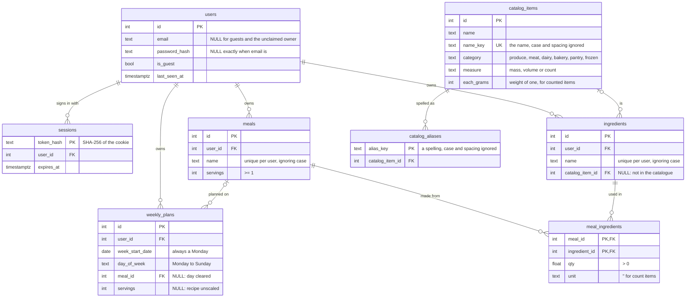

# Database schema

Nine tables. Everything a person creates is owned by one row in `users`, and
deleting that row deletes everything it owns. The conventions behind the
names and constraints are in [conventions.md](conventions.md), and
`tests/test_conventions.py` checks them.

Every table also has `created_at` and `updated_at`, set by the database.

`rate_limits` stands apart from the diagram: one row per throttled subject
(`scope`, `subject`), where `subject` is a keyed hash of an email or network,
never the value. It belongs to no user and references nothing. See
app/ratelimit.py for the rules.

## Tables

**users.** One row per person. Three kinds, told apart by columns rather
than a type field: a *guest* (`is_guest`, no credentials) identified only by
a session cookie and removed after a period without a visit; an *account*
(email and password hash), which a guest becomes in place when signing up so
their data comes with them; and the *unclaimed owner* (neither), the single
account the accounts migration gave the data from before accounts existed,
which gains credentials when claimed. Check constraints keep these
consistent: an email always has a password hash and vice versa, and a guest
never has an email. Emails are unique ignoring case.

**sessions.** A signed-in browser. The cookie holds a random token and the
table holds only its SHA-256, so a copy of the table cannot be replayed as
live sessions. Indexed by `expires_at` for cleanup.

**meals.** A recipe and the servings it yields. A name is unique per person,
ignoring case: two people can both have "Spaghetti Bolognese", one person
cannot have it twice. The unique index's leading column, `user_id`, also
serves every lookup by owner.

**ingredients.** The items in one person's kitchen, shared by their meals.
Per person rather than global, so one person's spelling never becomes
everyone's and the autocomplete never suggests a stranger's ingredient.

**catalog_items** and **catalog_aliases.** The ingredient catalogue:
common grocery items shared by everyone, with each item's aisle, how it is
measured and the typical weight of one. Every spelling that means an item,
its own name included, is a row in `catalog_aliases`, so linking a name is
one lookup. Reference data, not anyone's: loaded from `app/catalog.csv` by
`python -m app.jobs sync-catalog` (run by the migrate workflow, and
automatically for a local database), and read-only to the web app. An
ingredient links to the item its name or an alias matches when it is
created, and the sync job relinks everything when the catalogue changes;
anything unmatched stays private and unlinked. See app/catalog.py.

**meal_ingredients.** How much of an ingredient a meal uses. `qty` is
positive; `unit` is empty for count items ("2 onions").

**weekly_plans.** The meal on one day of one week for one person, unique on
`(user_id, week_start_date, day_of_week)`. A row with no meal is a day
deliberately cleared, which is different from a day never set (no row).
`servings` NULL means cook the recipe as written.

## What happens on delete

| Deleting | Effect | Why |
|---|---|---|
| a user | their sessions, meals, ingredients and plans go too (`CASCADE`) | nothing a person owns outlives them |
| a meal | its ingredient lines go (`CASCADE`); days it was planned on stay, cleared (`SET NULL`) | a plan for a week is still the week's plan with one day emptied |
| an ingredient still on a meal | refused (`NO ACTION`) | the meal would silently lose a line |
| a catalogue item | its aliases go (`CASCADE`); ingredients linked to it stay, unlinked (`SET NULL`) | a person's ingredient is theirs, whatever the catalogue does |

The last is `NO ACTION` rather than `RESTRICT` on purpose. `RESTRICT` is
checked the moment a row is deleted, so deleting a user - which removes
their meals and their ingredients in whatever order the database chooses -
failed on SQLite whenever the ingredients went first. `NO ACTION` is
checked at the end of the statement, by which time the meal lines are gone
as well. A test deletes a user with a full set of data to prove it.

## Row-level security (Postgres)

The web app connects as `meal_planner_app`, a role with no superuser or
`BYPASSRLS` attribute that can read and write rows but not change the schema.
At the start of each request the app declares whose request it is with
`set_config('app.user_id', <id>, true)`, which lasts only until the
transaction ends. Four tables carry a policy that compares each row with
`current_app_user_id()`:

| Table | A row is visible and writable when |
|---|---|
| `meals`, `ingredients` | `user_id` is the declared user |
| `weekly_plans` | `user_id` is the declared user, and any `meal_id` is one of their meals |
| `meal_ingredients` | its meal is theirs, and (on write) its ingredient is too |

So a query that forgot its `WHERE user_id = ...` still returns only one
person's rows, and a request that never declared a user sees nothing at
all. `users` and `sessions` have no policy, because signing in must find a
session or an email before anyone is known; only `app/auth.py` reads them.
The catalogue tables have no policy either, because they are everyone's;
the runtime role may only read them, so even a compromised app cannot
rewrite the catalogue.
The owner role, used by migrations and scheduled jobs, is not subject to
the policies (they are enabled, not forced), because that work spans users.
`tests/test_rls.py` proves all of this connected as `meal_planner_app`, to a
schema built by the migrations.

## Ownership of what a row points at

A plan's `meal_id` must belong to the same person as the plan, and a meal's
ingredients must belong to the same person as the meal. A foreign key checks
only that the row exists, not who owns it. Composite foreign keys such as
`(user_id, meal_id)` would enforce it, but `ON DELETE SET NULL` on one of
those would also null `user_id` unless the database supports a column list
(Postgres 15+; SQLite does not). Instead it is checked twice: the
repositories check ownership on every write, and in Postgres the row-level
security policies above refuse the write too. On SQLite, used for local
development and tests, only the first check exists.
